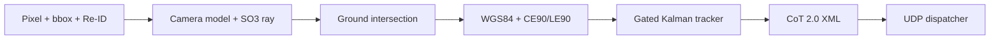

# sightline-cot

Real-time monocular 3D ranging, multi-target tracking and Cursor-on-Target (CoT) telemetry in pure Rust with a C-ABI.

Zero external dependencies: the crate uses only the Rust standard library (edition 2021) and builds as `rlib`, `cdylib` and `staticlib`.

License: MIT.

## Pipeline



## Mathematical model

- Camera: pinhole or equidistant fisheye intrinsics back-project a pixel `(u, v)` into a unit ray. Fisheye undistortion inverts `r_d = theta * (1 + k1*theta^2 + k2*theta^4)` with bounded Newton-Raphson.
- Attitude: roll, pitch and yaw build an SO(3) rotation into local East-North-Up (ENU). Rays with `ray_enu.z >= -1e-6` are rejected as above the horizon.
- Ground range: `t = (ground_up_m - cam_up_m) / ray_enu.z` gives the ENU ground point.
- Uncertainty: `J * Sigma * J^T` propagates pixel and attitude variance into `ce90_m = 2.146 * sqrt(0.5 * (var_e + var_n))` and `le90_m = 1.6449 * sqrt(var_u)`.
- Geodesy: ENU offsets convert to WGS84 (`a = 6378137.0`, `f = 1/298.257223563`) through ECEF.

## Tracking and CoT

- Tracker: 4-state constant-velocity Kalman filter over `[east, north, vel_e, vel_n]` with Joseph-stabilized covariance update.
- Association: squared Mahalanobis distance gated at the 95% chi-square value `5.991`, then either a bbox IoU or a cosine Re-ID threshold.
- Lifecycle: tracks confirm at `hits >= min_hits`, coast without updates, and are pruned when `time_since_update > max_age`.
- CoT: events serialize to CoT 2.0 XML (`<event version="2.0">`) with strict attribute escaping, and ship over a non-blocking `std::net::UdpSocket`.

## Build and test

```sh
cargo fmt --all -- --check
cargo clippy --all-targets -- -D warnings
cargo test --all-targets
cargo run --release --example bench_pipeline
```

## C-ABI

The C interface exports `sightline_engine_new`, `sightline_engine_free`, `sightline_engine_step` and `sightline_track_to_cot_xml`, declared in `include/sightline.h`.

Every entry point validates pointers, alignment, and buffer bounds, catches panics, and returns `SIGHTLINE_OK` (0) or a negative error code.

## Benchmark

Deterministic 10,000-frame, 3-target scenario (pixel, bbox and Re-ID to ground ray, WGS84, Kalman tracker, CoT XML). Scenario synthesis runs outside the timer. Measured with `cargo run --release --example bench_pipeline` on macOS arm64, three consecutive runs.

| Metric | Run 1 | Run 2 | Run 3 |
|---|---|---|---|
| Frames | 10000 | 10000 | 10000 |
| Latency p50 (us) | 5.46 | 5.00 | 4.83 |
| Latency p99 (us) | 9.71 | 7.67 | 7.42 |
| Latency mean (us) | 5.94 | 5.22 | 5.20 |
| Throughput (frames/s) | 168226.1 | 191732.4 | 192274.7 |

Timings vary between runs. The example also prints 3 confirmed tracks and a final position error under 1 mm against the synthetic truth.
