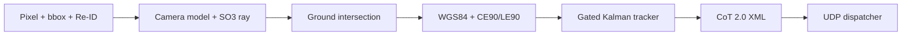

# sightline-cot

Real-time monocular 3D ranging, multi-target tracking and Cursor-on-Target (CoT) telemetry in pure Rust with a C-ABI.

Zero external dependencies: the crate uses only the Rust standard library (edition 2021) and builds as `rlib`, `cdylib` and `staticlib`.

License: MIT.

## Pipeline

